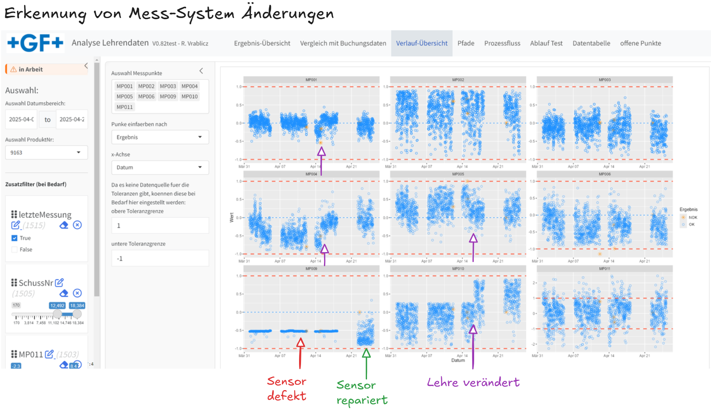
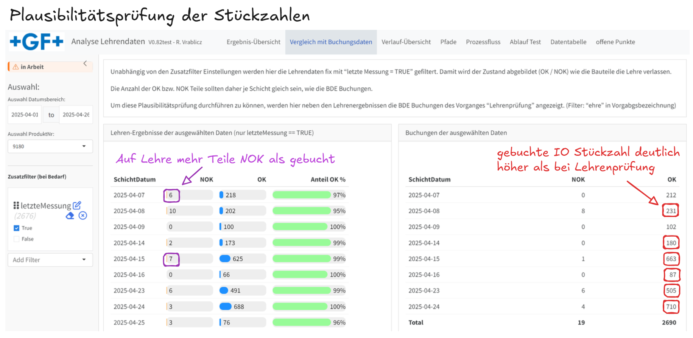
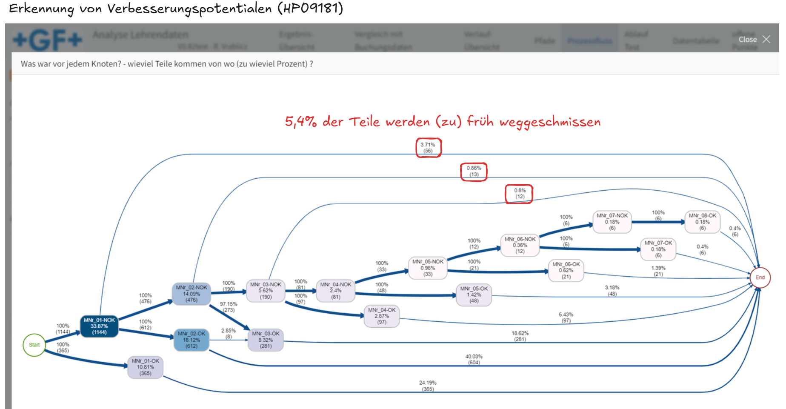

```{r setup}
#| context: setup
library(shiny)
library(shinyjs)
library(shinyBS)
library(plotly)
library(dplyr)
library(shinycssloaders)
library(reactable)
#library(reactablefmtr)
library(reactlog)
library(shinybusy)
library(IDEAFilter)    # für Zusatz Filter
#library(epoxy)         # für text mit variablen daten
# Für ProcessMining
library(bupaR)
#library(bupaverse)
#library(processanimateR)
library(processmapR)
library(DiagrammeR)

print('port 9901: KMM_Explorer')

hier <- paste0(here::here(),'/') # Slash am Ende des Pfades muss manuell hinzugefügt werden !

if(Sys.getenv("COMPUTERNAME") == "ATHEWS0462P") {
  gitrepo <- "C:/Users/vrablicz_r/git_repositories"
}
if(Sys.getenv("COMPUTERNAME") == "ATHENB0103C") {
  gitrepo <- "~/git_repositories"
}
if(Sys.getenv("COMPUTERNAME") == "VR-SurfacePro7") {
  gitrepo <- "~/gitRepos"
}

### für Lehren Original DB
# source(paste0(gitrepo,"/code_snippets/Lehren_DB/con_Lehre_9163.R"))
source(paste0(gitrepo,"/code_snippets/Lehren_DB/con_Lehre_Kerbl.R")) #V1.0
source(paste0(gitrepo,"/code_snippets/data_cleaning/erzeuge_Schichtdatum.R"))

### Module laden ---------------
source(paste0(gitrepo,("/code_snippets/shiny_modules/modul_Lehrendaten_Verlauf_0.R"))) #V0.7

### offizielle SAP Zahlen
source(paste0(gitrepo,("/code_snippets/DB/query_DG_Buchung_fast.R")))
source(paste0(gitrepo,("/code_snippets/Stammdaten/COStamm_Arbeitsplatz_Translation_V2.R")))
df_Vorgang_translate <- COStamm_Vorgang_Translation()
df_Vorgang_translate <- df_Vorgang_translate %>% 
  group_by(ProduktNr, Arbeitsplatz, Vorgang) %>% 
  summarize(Vorgang_Name = paste(Vorgang_Name, collapse=';')) %>% 
  ungroup()

reactstyle <- list(fontFamily = "Work Sans, sans-serif", fontSize = "0.7rem") 
reactcolDef <- colDef(
                  align = 'center',
                  minWidth = 45,
                  headerStyle = list(background = "lightblue"),
                  format=colFormat(digits=3)
                  )
reactcol <-   list(
                  .selection = colDef(minWidth = 20, sticky='left'),
                  DMC =colDef(minWidth = 200, filterable=TRUE, sticky='left'),
                  Datum = colDef(minWidth = 120, format = colFormat(datetime = TRUE, locales = "sv-SE")),
                  #SchichtDatum = colDef(minWidth = 130, cell= function(value) {format=lubridate::ymd_hms(value)}),
                  SchussNr = colDef(minWidth = 80, format=colFormat(digits=0), filterable = TRUE),
                  AX_Status = colDef(minWidth = 70, filterable = TRUE),
                  MessungNr = colDef(minWidth = 70, filterable = TRUE),
                  letzteMessung = colDef(name='letztMess', minWidth = 80),
                  Ergebnis = colDef(minWidth = 60, sticky='left', filterable = TRUE)
                )
```


#  {.sidebar width="14%"}

::: sidebar-footer
```{r}
cat('letzter App-Start: ', format(Sys.time(), '%d.%b.%Y %H:%M'))
```
:::

::: callout-warning
## in Arbeit
:::

***

#### {.toolbar} 

**letzte :  ** 

```{r}
actionButton("last3", "3 Tage")
actionButton("last7", "7 Tage")
```

#### Auswahl:

```{r sidebar}
      dateRangeInput("dateRange", "Auswahl Datumsbereich:", start = Sys.Date()-7, end = Sys.Date() +1)
      selectInput('produktnr', 'Auswahl ProduktNr:', choices = c('9163', '9180', '9181', '9182'))
```

```{r}
#| context: server
 observeEvent(input$last3, {
   newStart <- Sys.Date() - 3
   newEnd <- Sys.Date() +1
   updateDateRangeInput(session, "dateRange",start = newStart, end = newEnd)
 })
 observeEvent(input$last7, {
   newStart <- Sys.Date() - 7
   newEnd <- Sys.Date() +1
   updateDateRangeInput(session, "dateRange",start = newStart, end = newEnd)
 })
```


```{r, eval = F}
  # Auswahl der TeilNr - Erweiterung fall nötig
  output$teilnr_ui <- renderUI({
    selectizeInput("teilnr", "2. Wähle TeilNr:", 
                   choices = query_KMM_Teil(input$dateRange[[1]],input$dateRange[[2]]), multiple = TRUE)
  })
```

```{r}
    bslib::tooltip( 
      actionButton(
        inputId="apply_filter", 
        label= "ausgewählte Daten abrufen", class = "btn-kleiner"), 
      "Datenabfrage aufgrund der Auswahlkriterien", 
      placement = "top" 
    )
```


------------------------------------------------------------------------

**Zusatzfilter (bei Bedarf)**

```{r zusatzfilter, eval=T}
IDEAFilter_ui(id = "ideafilter") 
```

```{r ideafilter, eval=T}
#| context: server

# IDEAFilter braucht "reactive expression returning a data.frame" 
df_react <- reactive({
  as.data.frame(df()) 
  })

filtered_data <- # name the returned reactive data frame
   IDEAFilter(
     "ideafilter",     # give the filter a name(space)
     data = df_react,  # feed it raw data
     preselection = list("letzteMessung" = list(filter_fn = ~ .x == TRUE)),
     verbose = TRUE
    )

output$rt_daten_ideagefiltert <- renderReactable({
  filtered_data() %>%
    select(-Lehre) %>% 
    reactable(
      defaultPageSize = 100,
      defaultColDef = reactcolDef,
      style = reactstyle,
      columns=reactcol)
    })

Anzahl_Messungen_gefiltert <- reactive({nrow(filtered_data())})
```

```{r 01_Lehrendaten_lesen}
#| context: server
# Lehrendaten einlesen
df <- eventReactive(input$apply_filter, {
  df <- con_Lehre_Kerbl(
    ProduktNr = input$produktnr,
    vonDatum = as.POSIXct.Date(input$dateRange[[1]]), 
    bisDatum = as.POSIXct.Date(input$dateRange[[2]])) %>% 
    #select(-Lehre) %>% 
    collect()
  })
# Namen der Lehre extrahieren 
Lehre <- eventReactive(input$apply_filter, {
  Lehre <- con_Lehre_Kerbl(
    ProduktNr = input$produktnr,
    vonDatum = as.POSIXct.Date(input$dateRange[[1]]), 
    bisDatum = as.POSIXct.Date(input$dateRange[[2]])) %>% 
    select(Lehre) %>% unique() %>% collect() %>% pull(Lehre)
  })
```

```{r 01a_Buchungsdaten_lesen}
#| context: server

df_Buchung <- eventReactive(input$apply_filter, {
  Produkt <- input$produktnr
  df <- con_DG_Buchung_fast(vonDatum = as.POSIXct.Date(input$dateRange[[1]]), 
                              bisDatum = as.POSIXct.Date(input$dateRange[[2]])) %>% 
      filter(ProduktNr == Produkt) %>% 
      collect()%>% 
      mutate(SchichtDatum = substr(as.character(Schichtbeginn),1,10)) %>% select(-Schichtbeginn) %>%
      left_join(df_Vorgang_translate,by = join_by(Arbeitsplatz, ProduktNr, Vorgang)) %>% 
      group_by(#ProduktNr,
        SchichtDatum, #Schicht, 
        #Schichtbeginn, 
        Arbeitsplatz, #Ausschussgrund, 
        Vorgang_Name)  %>% 
      dplyr::summarize(NOK = sum(Stueck_AU, na.rm=T),
                       OK = sum(Stueck, na.rm=T)) %>% 
      ungroup() %>% 
      filter(grepl(c('ehre'), Vorgang_Name))
})
```

```{r Testdaten , eval=T}
#| context: server

df_Buchung_test <- con_DG_Buchung_fast(vonDatum = '2025-04-16', 
                                       bisDatum =  '2025-04-24') %>% 
    filter(ProduktNr == '9180') %>% 
    collect()%>% 
    mutate(SchichtDatum = substr(as.character(Schichtbeginn),1,10)) %>% select(-Schichtbeginn) %>% 
    left_join(df_Vorgang_translate,by = join_by(Arbeitsplatz, ProduktNr, Vorgang)) %>% 
    group_by(#ProduktNr,
      SchichtDatum, Schicht, 
      #Schichtbeginn, 
      Arbeitsplatz, Ausschussgrund, Vorgang_Name)  %>% 
    dplyr::summarize(Stk_AU = sum(Stueck_AU, na.rm=T),
                     Stk_NA = sum(Stueck_NA, na.rm=T),
                     Stk = sum(Stueck, na.rm=T)) %>% 
    ungroup() %>% 
  filter(grepl('ehre', Vorgang_Name))


# für Entwicklung
df_test <- con_Lehre_Kerbl(9163, '2025-04-01', '2025-04-15')
df_ergebnis_test <- df_test %>%
    dplyr::group_by(MessungNr, Ergebnis) %>%
    summarize(Anzahl = n()) %>%
    mutate(MessungNr = as.numeric(MessungNr))# %>%
    #mach_widedaten() 

df_ergebnis_test <- df_test %>%
    filter(letzteMessung == TRUE) %>% 
    mutate(SchichtDatum=substr(Datum,1,10)) %>% 
    dplyr::group_by(Ergebnis,SchichtDatum) %>%
    summarize(Anzahl = n()) #%>%
    #mach_widedaten(mitSchichtDat = TRUE)   #geht nur bei manuellem Test
 
 # df_ergebnis  %>% 
 #   mach_Ergebnis_rt() # geht nur in shiny wegen reactivem Value
```

# Ergebnis-Übersicht

```{r funktion_ergebnis}
#| context: server

mach_widedaten <- function(df, mitSchichtDat = FALSE) {
  df <- df %>%
  tidyr::pivot_wider(names_from = Ergebnis, values_from = Anzahl) %>% 
    ungr
  
  # wenn es keine NOKs gibt
  if (!'NOK' %in% colnames(df)) {
    df <- df %>% mutate(NOK = 0)
  }
  # NA-Werte durch 0 ersetzen
  df[is.na(df)] <- 0
  
  if(mitSchichtDat == FALSE) {
     df <- df %>% 
      mutate(Anteil_OK_relativ = OK / (OK + NOK)) %>%
      select(MessungNr, NOK, OK, Anteil_OK_relativ) %>%
      arrange(MessungNr)  
  } else if(mitSchichtDat == TRUE) {
    df <- df %>% 
      mutate(Anteil_OK_relativ = OK / (OK + NOK)) %>%
      select(SchichtDatum, NOK, OK, Anteil_OK_relativ) %>%
      arrange(SchichtDatum)  
  }

  return(df)
}

mach_Ergebnis_rt <- function(df) {
  df %>%
    reactable(
      width = 600,
      defaultPageSize = 100,
      columns = list(
        #MessungNr = colDef(minWidth = 75),
        Anteil_OK_relativ = colDef(
          minWidth = 150,
          name = 'Anteil OK %',
          cell = data_bars(
            .,
            round_edges = TRUE,
            number_fmt = scales::percent,
            max_value = 1,
            text_position = "outside-end",
            fill_color = 'palegreen'
          )
        ),
        OK = colDef(#footer = function(values) sum(values),
          cell = data_bars(
            .,
            round_edges = TRUE,
            max_value = Anzahl_Messungen_gefiltert(),
            text_position = "outside-end",
            fill_color = 'dodgerblue'
          )
        ),
        NOK = colDef(
          cell = data_bars(
            .,
            round_edges = TRUE,
            max_value = Anzahl_Messungen_gefiltert(),
            text_position = "outside-end",
            fill_color = 'darkorange'
          )
        )
      )
    )
}

```

## Total {height="20%"}

```{r, eval=T}
#| title: Ergebnisse der ausgewählten/gefilterten Daten

add_busy_spinner(spin ="atom",
                 margins = c(200, 700), color='dodgerblue', 
                 position = 'top-left')

reactableOutput('rt_daten_Ergebnisse_total')
```

```{r, eval=T}
#| title: Erklärung der Ergebnistabelle

  ui_epoxy_markdown(
    .id = "lehren_info_total",
      "In den ausgewählten Daten der Lehre __*{{ lehre }}*__ gibt es insgesamt __{{ total }} Messungen__. <br>",
      "Davon wurden __{{ NOK }}__ Messungen als __NOK__ und __{{ OK }}__ als __OK__ beurteilt. <br>
      Insgesamt waren daher __{{ Anteil_OK_relativ }} %__ der Messungen __OK__"
  )
```

```{r, eval=T}
#| context: server

df_ergebnis_total <- reactive({
  df<- filtered_data() %>%
    dplyr::group_by(Ergebnis) %>%
    summarize(Anzahl = n()) %>%
    mutate(MessungNr = 'Total')%>%
    mach_widedaten() 
})

output$rt_daten_Ergebnisse_total <- renderReactable({
  df_ergebnis_total() %>% 
    mach_Ergebnis_rt()
})

  # Pass the reactive data frame to
  # the .list argument of render_epoxy()
  output$lehren_info_total <- render_epoxy(.list = df_ergebnis_total() %>% 
                                             mutate(lehre = Lehre()) %>%
                                             mutate(total= NOK + OK) %>% 
                                             mutate(Anteil_OK_relativ = round(Anteil_OK_relativ*100,1)))
```

## pro Messung {height="80%"}

```{r, eval=T}
reactableOutput('rt_daten_Ergebnisse')
```

```{r, eval=T}
#| title: Erklärung der Tabelle je MessungNr
  ui_epoxy_markdown(
    .id = "lehren_info_01",
      "Bei der __{{ MessungNr }}. Messung__ der Teile wurden <br>",
      "__{{ NOK }}__ Messungen als __NOK__ und __{{ OK }}__ als __OK__ beurteilt. 
      Hier waren __{{ Anteil_OK_relativ }} %__ der Messungen __OK__"
  )

  ui_epoxy_markdown(
    .id = "lehren_info_02",
      "Bei der __{{ MessungNr }}. Messung__ der Teile wurden <br>",
      "__{{ NOK }}__ Messungen als __NOK__ und __{{ OK }}__ als __OK__ beurteilt. 
      Hier waren __{{ Anteil_OK_relativ }} %__ der Messungen __OK__ <br><br> usw."
  )
```

```{r, eval=T}
#| context: server

df_ergebnis <- reactive({
  df <- filtered_data() %>%
    dplyr::group_by(MessungNr, Ergebnis) %>%
    summarize(Anzahl = n()) %>%
    mutate(MessungNr = as.numeric(MessungNr)) %>%
    mach_widedaten() 
})

output$rt_daten_Ergebnisse <- renderReactable({
 df_ergebnis() %>% 
    mach_Ergebnis_rt()
})

  # Pass the reactive data frame to
  # the .list argument of render_epoxy()
  output$lehren_info_01 <- render_epoxy(.list = df_ergebnis() %>% 
                                       filter(MessungNr == 1) %>% 
                                             mutate(lehre = Lehre()) %>%
                                             mutate(total= NOK + OK) %>% 
                                             mutate(Anteil_OK_relativ = round(Anteil_OK_relativ*100,1)))
    output$lehren_info_02 <- render_epoxy(.list = df_ergebnis() %>% 
                                       filter(MessungNr == 2) %>% 
                                             mutate(lehre = Lehre()) %>%
                                             mutate(total= NOK + OK) %>% 
                                             mutate(Anteil_OK_relativ = round(Anteil_OK_relativ*100,1)))
```

# Vergleich mit Buchungsdaten

Unabhängig von den Zusatzfilter Einstellungen werden hier die Lehrendaten fix mit "letzte Messung = TRUE" gefiltert. Damit wird der Zustand abgebildet (OK / NOK) wie die Bauteile die Lehre verlassen.

Die Anzahl der OK bzw. NOK Teile sollten daher je Schicht gleich sein, wie die BDE Buchungen.

Um diese Plausibilitätsprüfung durchführen zu können, werden hier neben den Lehrenergebnissen die BDE Buchungen des Vorganges "Lehrenprüfung" angezeigt. (Filter: "ehre" in Vorgabgsbezeichnung)   

**ACHTUNG: Wenn die DMC's falsch sind stimmen die ermittelten Stückzahlen auch nicht !!!**  

## Tabellen {orientation="columns"}

### Lehrendaten {.width=60%}

```{r, eval=T}
#| context: server

df_ergebnis_vergleich <- reactive({
  df<- filtered_data() %>%
    filter(letzteMessung == TRUE) %>% 
    erzeuge_Schichtdatum()%>%
    filter(SchichtDatum >= input$dateRange[[1]]) %>% 
    dplyr::group_by(Ergebnis,SchichtDatum) %>%
    summarize(Anzahl = n()) %>%
    mach_widedaten(mitSchichtDat = TRUE) 
})

output$rt_daten_Ergebnisse_vergleich <- renderReactable({
  df_ergebnis_vergleich() %>% 
    #select(-MessungNr) %>% 
    mach_Ergebnis_rt()
})
```

```{r, eval=T}
#| title: Lehren-Ergebnisse der ausgewählten Daten (nur letzteMessung == TRUE)

add_busy_spinner(spin ="atom",
                 margins = c(200, 700), color='dodgerblue', 
                 position = 'top-left')

reactableOutput('rt_daten_Ergebnisse_vergleich')
```

### Buchungsdaten {.width=40%}

```{r}
#| context: server
output$rt_Buchung <- renderReactable({
  df_Buchung() %>% 
    select(- c(Arbeitsplatz,Vorgang_Name)) %>% 
    reactable(
    defaultPageSize = 100,
    columns = list(
      SchichtDatum = colDef(footer = "Total"),
      NOK = colDef(footer = function(values) sum(values)),
      OK = colDef(footer = function(values) sum(values))
  ),
  defaultColDef = colDef(footerStyle = list(fontWeight = "bold"))
    )
})
```

```{r}
#| title: Buchungen der ausgewählten Daten

add_busy_spinner(spin ="atom",
                 margins = c(200, 700), color='dodgerblue', 
                 position = 'top-left')

reactableOutput('rt_Buchung')
```

# Verlauf-Übersicht

##  {.sidebar width="18%"}

```{r}
m_Lehrendaten_Verlauf_0_UI(id='Parameter')
```

## Grafik

```{r}
plotOutput('grafik0')
```

```{r}
#| context: server
# Grafikmodul
output$grafik0 <- m_Lehrendaten_Verlauf_0_server(id='Parameter', lehrendaten = filtered_data)
```

# Pfade


# Prozessfluss

##  {.sidebar width="18%"}

```{r sidebar2}

selectInput('variante', 'Darstellung der ProcessMap: ', choices = c('Variante 1', 'Variante 2'))
numericInput('perc_trace_freq', label = 'Anteil der dargestellten Pfade: ',value = 1,min = 0,max = 1,step = 0.01)
```

## ProcessMap 1

```{r}
#| title: Was war vor jedem Knoten? - wieviel Teile kommen von wo (zu wieviel Prozent) ?
processMapOutput("processMap_02")
```

## ProcessMap 2

```{r}
#| title: Was passiert nach jedem Knoten? - wieviel Teile gehen wohin (zu wieviel Prozent) ?
processMapOutput("processMap_01")
```

```{r, eval=F}
processMapOutput("processMap_anim")
```

```{r}
#| context: server
df_L0 <- reactive({
  filtered_data() %>% 
  mutate(Status = paste0('Messung ', MessungNr)) %>% 
  mutate(Messung_Ergebnis = paste0('MNr_',MessungNr, '-', Ergebnis))
})

df_LE <- reactive({
  df_L0() %>% select(DMC,ID,Datum, Lehre, Ergebnis) %>% 
  mutate(Datum = Datum + 6) %>% 
  mutate(Status = Ergebnis) 
})

df_L <- reactive({
  bind_rows(df_L0(), df_LE()) %>% arrange(Datum)
})
```

```{r}
#| context: server

evlog <- reactive({
  if(input$variante == 'Variante 1') {
    elog <- df_L() %>%
      eventlog(
        case_id = 'DMC',
        activity_id = 'Status',
        activity_instance_id = 'ID',   # Was gehört hier hin? 'MessungNr' oder 'ID' oder ?? eher nicht MessungNr
        lifecycle_id='ID',
        timestamp= 'Datum',
        resource_id= 'Lehre',
        order = 'ID', 
        validate = F  # mit F erfolgt kein check und damit wird Fehlermeldung verhindert
      )
  }
  if(input$variante == 'Variante 2') {
    elog <- df_L() %>% filter(!is.na(Messung_Ergebnis)) %>% 
      eventlog(
        case_id = 'DMC',
        activity_id = 'Messung_Ergebnis',
        activity_instance_id = 'ID',   # Was gehört hier hin? 'MessungNr' oder 'ID' oder ?? eher nicht MessungNr
        lifecycle_id='ID',
        timestamp= 'Datum',
        resource_id= 'Lehre',
        order = 'ID', 
        validate = F  # mit F erfolgt kein check und damit wird Fehlermeldung verhindert
      )
  }
 # elog <- elog %>% mutate(end_Status='OK') # für test
  return(elog)
})


# end_activity hinzufügen - mit end_Status - wichtig für Farbe in animation

# fkt nicht, immer wieder Fehler "invalid(NULL) left side of assignment"
# evlogend() <- reactive({
#   elog <- evlog()
#   elog <- elog %>%
#   end_activities("case") %>%
#   augment(elog, prefix = "end")
#   return(elog)
# })

output$processMap_00 <- 
  renderProcessMap(
    evlog() %>% 
      filter_trace_frequency(percentage = input$perc_trace_freq) %>%
      process_map()
)

output$processMap_01 <- 
  renderProcessMap(
    evlog() %>% 
      filter_trace_frequency(percentage = input$perc_trace_freq) %>%
      process_map(frequency('relative'), sec = frequency("absolute"),render=T)
)

output$processMap_02 <- 
  renderProcessMap(
    evlog() %>% 
      filter_trace_frequency(percentage = input$perc_trace_freq) %>%
      process_map(frequency('relative-consequent'), sec = frequency("absolute"),render=T)
)

#### Animation fkt nicht !?
# p2F <- reactive({
  # evlog() %>% 
  #     filter_trace_frequency(percentage = 1) %>%
  #     process_map(frequency('relative'), sec = frequency("absolute"),render=F)
# })
# p2a <- reactive({
#     animap(evlog(), p2F(), dauer = 120, 'off')
# }) 

# output$processMap_anim <- renderProcessMap(p2a())

```


```{r anmationFunktion, eval=F}
#| context: server

# Ablauf Test
animap <- function(eventlog, pmap, dauer=30, modus='absolute') {
  amap <- eventlog %>% 
    animate_process(
      processmap = pmap,
      mode = modus,
      duration= dauer,          
      epsilon_time = dauer/100,  #  Animation von kurzen Zeite und langen Pausen wird dadurch besser
      jitter = 10, legend = "color",
      token_callback_onclick = c("function(svg_root, svg_element, case_id) {", "}"),
      mapping = token_aes(opacity = token_scale(0.6) #,
        # color = token_scale("end_Status",
        #                   scale = "ordinal",
        #                   #range = RColorBrewer::brewer.pal(8, "Paired")
        #                   range = c('red',"green", 'magenta')
        #                   )
        )
      )
  return(amap)
} 
```

```{r, eval=F}
## ProcessMap
#| title: ProcessMap Darstellung fkt nicht auf Remote Rechner
processMapOutput("processMapTest")
```

```{r, eval=F}
#| title: Process Map Animation fkt. nicht in shiny? 
processMapOutput("processMapTest1")
```

```{r, eval=F}
#| title: p2FT
processMapOutput("processMapTest2")
```

```{r}
#| context: server
df_L0_test <- 
  df_test %>% 
  mutate(Status = paste0('Messung', MessungNr)) %>% 
  mutate(Messung_Ergebnis = paste0('MNr_',MessungNr, '-', Ergebnis))


df_LE_test <- 
  df_L0_test %>% select(DMC,ID,Datum, Lehre, Ergebnis) %>% 
  mutate(Datum = Datum + 6) %>% 
  mutate(Status = Ergebnis) 


df_L_test <- 
  bind_rows(df_L0_test, df_LE_test) %>% arrange(Datum)

```

```{r}
#| context: server

evlog_test <- 
 # if(input$variante == 'Variante 1') {
    df_L_test %>%
      eventlog(
        case_id = 'DMC',
        activity_id = 'Status',
        activity_instance_id = 'ID',   # Was gehört hier hin? 'MessungNr' oder 'ID' oder ?? eher nicht MessungNr
        lifecycle_id='ID',
        timestamp= 'Datum',
        resource_id= 'Lehre',
        order = 'ID', 
        validate = F  # mit F erfolgt kein check und damit wird Fehlermeldung verhindert
      )

evlog_test <- evlog_test %>%
  end_activities("case") %>%
  augment(evlog_test, prefix = "end")


p2T <- evlog_test %>% 
      filter_trace_frequency(percentage = 1) %>%
      process_map()
output$processMapTest <- renderProcessMap(p2T)

p2F <- evlog_test %>% 
      filter_trace_frequency(percentage = 1) %>%
      process_map(render=F)
#p2a <- animap(evlog_test, p2F, dauer = 120)
output$processMapTest1 <- renderProcessMap(p2a)

p2FT <- render_graph(p2F, output='graph') 
output$processMapTest2 <- renderProcessMap(p2FT)

# save(p2F, file = 'p2F.txt')
```


## eigene Darstellung

```{r}
#| title: Wieviel Teile (%) nehmen welchen Weg?
reactableOutput('rt_trace_explorer')
```

## Trace Explorer

```{r, eval=F}
#| title: Wieviel Teile (%) nehmen welchen Weg?
plotOutput("trace_00")
```

```{r}
#| context: server

  # Trace explorer
  output$rt_trace_explorer <- renderReactable({
    # Check if activity_filter() has data - don't render
    # req(is.na(filtered_data()) != TRUE)
    rt <- evlog() %>%
      trace_coverage(level = "trace") %>% 
      arrange(cum_sum) %>% 
        reactable(
                width = 800,
                defaultPageSize = 100,
                columns = list(
                  absolute = colDef(name='absolut'),
                  trace = colDef(name='Pfad', minWidth = 200, filterable = TRUE),
                  relative = colDef(
                      minWidth = 60,
                      name = 'relativ %',
                        cell = data_bars(
                          .,
                          round_edges = TRUE,
                          number_fmt = scales::percent,
                                      max_value = 1,
                          text_position = "outside-end",
                          fill_color = 'skyblue'
                          )
                      ),
                  cum_sum = colDef(
                      minWidth = 60,
                      name = 'kumuliert %',
                        cell = data_bars(
                          .,
                          round_edges = TRUE,
                          number_fmt = scales::percent,
                                      max_value = 1,
                          text_position = "outside-end",
                          fill_color = 'skyblue'
                          )
                  )
                )
        )
    rt
  })


activity_colors <- c('Messung 01'='paleturquoise3',
           'Messung 02'='skyblue',
           'Messung 03'='cornflowerblue',
           'Messung 04'='dodgerblue',           
           'Messung 05'='royalblue',
           'OK' = 'forestgreen', 'NOK'='darkorange')

output$trace_00 <- 
  renderPlot(
    p<- reactive({
      evlog() %>%
      trace_explorer(n_traces = 11) %>% plot()
  })
  )


# output$trace_00 <- 
#   renderPlot(
#     # Farben manuell zuweisen (direkt zuweisen fkt. nicht !?)
#       p <- reactive({
#         p() + scale_fill_manual(values = activity_colors) 
#     })
#   )

```


# Datentabelle

## Lehrendaten detailliert {height="65%"}

```{r}
#| title: gefilterte und aufbereitete Originaldaten von der SQL Datenbank der gewählten Lehre
add_busy_spinner(spin ="atom",
                 margins = c(200, 700), color='dodgerblue', 
                 position = 'top-left')
reactableOutput('rt_daten_ideagefiltert')
```

# Anwendungsbeispiele

{width="1812"}

------------------------------------------------------------------------



------------------------------------------------------------------------



# offene Punkte

::: callout-note
## Technisch

-   Es gibt keinen Nachweis, dass die Lehren richtig messen (MSA1, MSA2, Linearität, Stabilität)

-   Die Messunsicherheit ist unbekannt

-   Es gibt keine Datenquelle für die eingestellten Toleranzen

-   Es gibt keine Datenquelle für die DMC-Codes der Eichmeister
:::

------------------------------------------------------------------------

::: callout-note
## Organisatorisch

-   Welche Fragen zum Thema Lehrenmessung sollen beantwortet werden ?

-   Wer soll mit den Analyseergebnissen arbeiten ?
:::
